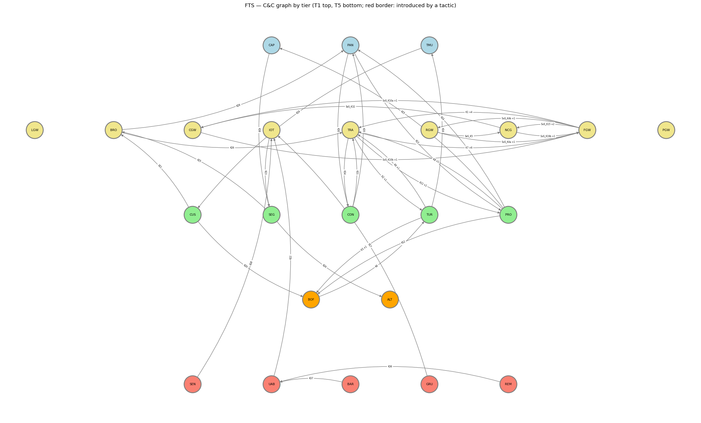
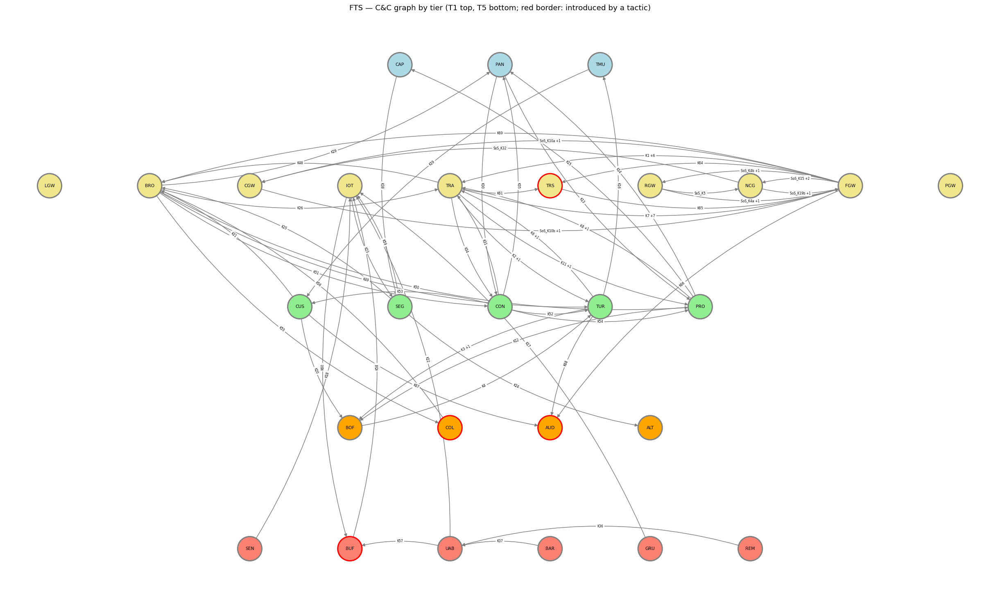
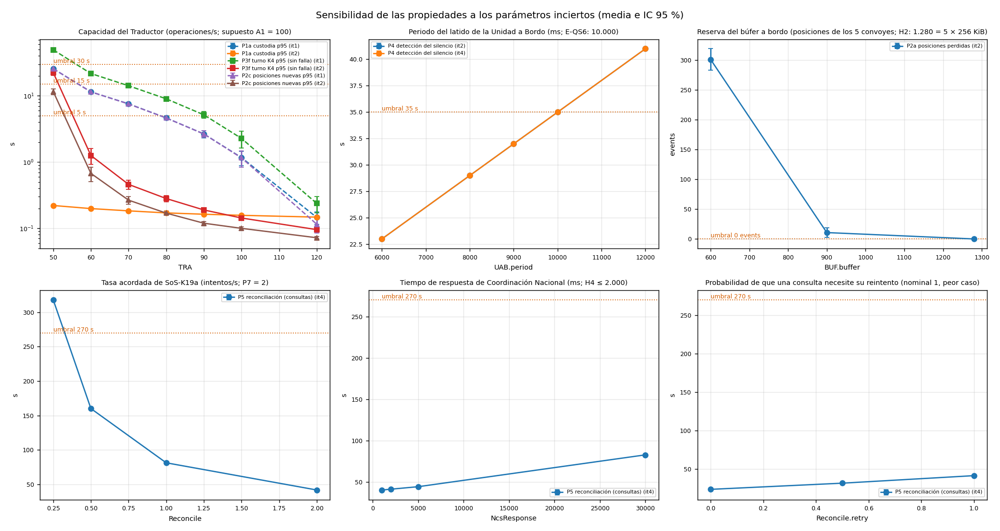
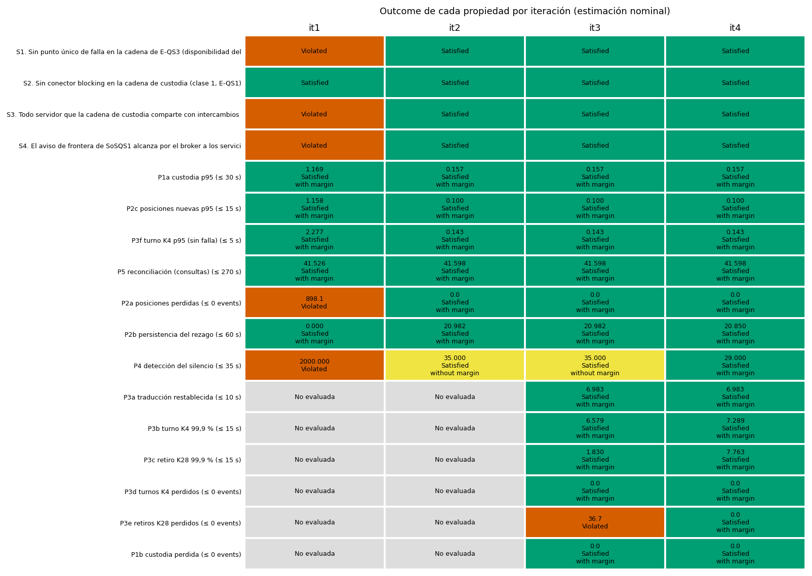

<div class="cover" markdown="1">

<p class="cover-course">Large-Scale Software Architecture (LSSA) · 2026-II</p>

<p class="cover-title">P4 – Verificación arquitectónica del SoS</p>

<p class="cover-sub">Entrega 4 · Equipo E · Sistema de Transporte Fluvial (FTS)</p>

<p class="cover-block"><strong>Presentado por:</strong><br>
Breyner Ismael Ciro Otero<br>
Helbert Andrés Marroquin García<br>
Julián Casas<br>
Sebastian Ortiz Gonzalez<br>
Yeison Arley Forero Rodríguez</p>

<p class="cover-block"><strong>Profesores:</strong><br>
Jeisson Andrés Vergara Vargas<br>
Camilo Ernesto Vargas Romero</p>

<p class="cover-block"><strong>Universidad Nacional de Colombia</strong><br>
Facultad de Ingeniería<br>
Departamento de Ingeniería en Sistemas e Industrial<br>
2026</p>

</div>

# 1. Información del equipo

**Equipo: E**

| N.º | Nombre completo |
|:-:|---|
| 1 | Breyner Ismael Ciro Otero |
| 2 | Helbert Andrés Marroquin García |
| 3 | Julián Casas |
| 4 | Sebastian Ortiz Gonzalez |
| 5 | Yeison Arley Forero Rodríguez |

Profesores: Jeisson Andrés Vergara Vargas y Camilo Ernesto Vargas Romero.

**Convenciones del documento.** Los números usan coma decimal; los de cuatro cifras se escriben sin separador (1800 s) y los mayores con espacio (900 000 ms). Todas las cifras de resultados están copiadas de los reportes generados en `out/` por `python run_all.py` (10 réplicas, semillas 1 a 10 en cada punto; la corrida es determinista). Los resultados de cada propiedad (*outcome*) se escriben con los términos del enunciado, en inglés y siempre igual: **Satisfied with margin**, **Satisfied without margin**, **Inconclusive**, **Violated** y **Not verifiable**. Los identificadores `SoS-K5` y `E-K1` se escriben `SoS_K5` y `E_K1` en los modelos.

# 2. Sistema constituyente

| Campo | Descripción |
|---|---|
| Nombre | Sistema de Transporte Fluvial (Fluvial Transportation System, FTS). En los modelos: constituyente `FTS`. |
| Dueño | Operadores de navegación fluvial del río Magdalena: empresas de remolcadores, convoyes y barcazas, y operadores de los terminales fluviales donde se transfiere la carga. Cada operador gobierna su flota, su programación de viajes y su tecnología. La autoridad fluvial regula la navegación, pero no opera el sistema. |
| Propósito en el SoS | Mover carga en convoyes de remolcador y barcazas entre los puertos del Caribe y los puertos fluviales del interior, como modo de gran volumen que complementa al carretero y al férreo en el corredor Caribe–interior. |
| Frontera | El FTS interactúa con el SoS solo a través del Fluvial Gateway (`FGW`, T2), componente de frontera declarado en `sos.arch`. Participa en 13 conectores globales: SoS-K4a/b, SoS-K10a/b, SoS-K15, SoS-K16, SoS-K19a/b, SoS-K28a/b, SoS-K31a/b y SoS-K35. |
| Modelos verificados | Cuatro, uno por iteración: `fts-it1.arch` (estructura de partida, 19 componentes y 46 conectores internos), `fts-it2.arch` (estructura resultante de la Entrega 2, 23 componentes y 69 conectores internos), `fts-it3.arch` (resultante con lo que el escenario B necesita) y `fts-it4.arch` (rediseñada). |

# 3. Nivel global (acuerdo conjunto)

## 3.1. Estado del acuerdo

El enunciado (§4.1) pide que los seis equipos acuerden e incluyan idénticos cuatro elementos: (1) el núcleo del lenguaje con su versión, (2) el modelo final del SoS (`sos.arch`), (3) la tabla *bottom-up* de SoS-QS1 y (4) la verificación *top-down* de SoS-QS1. **A la fecha de este informe esos cuatro elementos no están acordados entre los seis equipos.** Este capítulo deja marcado el lugar de cada uno para pegarlo idéntico cuando exista, y presenta por separado lo que sí es responsabilidad del equipo E: la fila del FTS para la tabla *bottom-up*, sus conectores de frontera y una propuesta para atender la observación del profesor sobre `sos.arch`. Nada de lo que aparece en §3.6 y §3.7 es un acuerdo: son insumos del equipo E.

## 3.2. Elemento 1: núcleo del lenguaje y versión

**[PENDIENTE: acuerdo conjunto]** — Versión del núcleo del lenguaje acordada por los seis equipos.

Base de trabajo del equipo E mientras se cierra el acuerdo: `arch.tx` declara `core v2.0` = Laboratorio 4 (v1.0, restricciones C1 a C5) + Laboratorio 5 (`capacity`, `store`, `scenario`, `workload`, `fault`, `vary`, `measure`; restricciones C6 y C7). Todo lo que agrega el equipo está marcado `[E]` y es opcional, de modo que un modelo escrito en el núcleo se acepta sin cambios (§4).

## 3.3. Elemento 2: modelo final del SoS (`sos.arch`)

**[PENDIENTE: acuerdo conjunto]** — Modelo final del SoS acordado por los seis equipos.

El archivo `models/sos.arch` incluido en esta entrega es el del acuerdo v4 que acompañó a la Entrega 3 y **no se modificó**: seis constituyentes, seis componentes de frontera (T2), los conectores globales SoS-K1 a SoS-K36 con sus acuerdos, y el análisis `SoSQS1M4`. Es la referencia contra la que se comprueba la correspondencia de los cuatro modelos del FTS (§4.3). Cuando el acuerdo cambie este archivo, basta reemplazarlo y ejecutar de nuevo `run_all.py`: el chequeo de correspondencia falla si el FTS diverge.

## 3.4. Elemento 3: tabla *bottom-up* de SoS-QS1

**[PENDIENTE: acuerdo conjunto]** — Tabla conjunta con el presupuesto, la medida verificada y el outcome de cada constituyente y conector de frontera.

La fila que aporta el equipo E está en §3.6.

## 3.5. Elemento 4: verificación *top-down* de SoS-QS1

**[PENDIENTE: acuerdo conjunto]** — Composición de las medidas verificadas de los seis constituyentes, outcome y sensibilidad.

El equipo E no compone medidas de otros constituyentes en este informe. Los modelos del FTS conservan, copiado de `sos.arch`, el análisis `SoSQS1M4` de presupuestos (200 000 + 40 000 + 230 000 + 10 000 + 300 000 = 780 000 ms ≤ 900 000 ms; `out/fts-itN/analysis.md`). Esa cifra es la composición de **presupuestos** de la Entrega 3, no una verificación *top-down* con medidas verificadas.

## 3.6. Aporte del equipo E: fila del FTS y conectores de frontera

Fuente: `out/sos-qs1-fts.md`. Presupuesto asignado al FTS por el acuerdo v4: reconciliación local ≤ 300 s desde el aviso «restablecido» (SoS-K35). El equipo lo reparte en ≤ 270 s para consultas y reintentos y ≤ 30 s para aplicar los resultados (Entrega 2, §5.2).

Estímulo verificado (escenario `Recovery`): 40 unidades pendientes, una consulta por unidad por SoS-K19a/b detrás de un limitador de 2 intentos/s (P7), cada consulta necesita su único reintento (80 intentos, peor caso de H4), respuesta de la frontera NCS de 2 s, con la carga de recuperación H1 + H3 sobre el Traductor compartido.

**Fila para la tabla conjunta (modelo final, `fts-it4.arch`):**

<div class="small" markdown="1">

| Constituyente o conector | Presupuesto | Medida verificada | Técnica | Outcome |
|---|---|---|---|---|
| FTS: reconciliación local (M4) | ≤ 300 s | 71,6 s [71,5; 71,7] (41,598 s simulados de consultas + 30 s de presupuesto para aplicar) | Simulación, 10 réplicas, IC 95 % | Satisfied with margin |
| FTS: consultas por SoS-K19a | ≤ 2 intentos/s y ≤ 80 intentos (P7, H4) | 2 intentos/s y 80 intentos | Por construcción: limitador del escenario (`rate 2 count 40 retry 1`) | Satisfied |
| FTS: recepción del aviso SoS-K35 por los servicios (S4) | Alcanzable por el broker | it1: Violated; it2–it4: Satisfied | Análisis del grafo | Satisfied |
| SoS-K19a/b: respuesta de la frontera NCS | ≤ 2 s por consulta | No verificada por el FTS: es un parámetro de Coordinación Nacional (entra como `delay NcsResponse`) | — | Not verifiable (otro dueño) |

</div>

La medida es prácticamente la misma en las cuatro iteraciones, porque la domina la tasa acordada y no la estructura del FTS:

| Iteración | Consultas y reintentos [IC 95 %] | Aplicar (presupuesto, no simulado) | Reconciliación local | Presupuesto | Outcome |
|---|---|---|---|---|---|
| it1 | 41,526 s [41,513; 41,539] | 30 s | 71,5 s [71,5; 71,5] | ≤ 300 s | Satisfied with margin |
| it2 | 41,598 s [41,467; 41,728] | 30 s | 71,6 s [71,5; 71,7] | ≤ 300 s | Satisfied with margin |
| it3 | 41,598 s [41,467; 41,728] | 30 s | 71,6 s [71,5; 71,7] | ≤ 300 s | Satisfied with margin |
| it4 | 41,598 s [41,467; 41,728] | 30 s | 71,6 s [71,5; 71,7] | ≤ 300 s | Satisfied with margin |

**Sensibilidad a parámetros de otros dueños (modelo final).** Reconciliación local = consultas + 30 s.

<div class="small" markdown="1">

| Parámetro | Dueño | Valor | Consultas [IC 95 %] | Reconciliación local | Outcome frente a 300 s |
|---|---|---|---|---|---|
| Tasa acordada P7 (intentos/s) | Acuerdo FTS–Coordinación Nacional | 0,25 | 318,020 s [318,011; 318,030] | 348,0 s | **Violated** |
| | | 0,5 | 160,021 s [160,013; 160,029] | 190,0 s | Satisfied with margin |
| | | 1 | 81,151 s [81,032; 81,269] | 111,2 s | Satisfied with margin |
| | | 2 (nominal) | 41,598 s [41,467; 41,728] | 71,6 s | Satisfied with margin |
| Respuesta de la frontera NCS | Coordinación Nacional | 1 s | 40,561 s [40,504; 40,619] | 70,6 s | Satisfied with margin |
| | | 2 s (nominal) | 41,598 s [41,467; 41,728] | 71,6 s | Satisfied with margin |
| | | 5 s | 44,597 s [44,496; 44,699] | 74,6 s | Satisfied with margin |
| | | 30 s | 83,006 s [82,195; 83,817] | 113,0 s | Satisfied with margin |
| Probabilidad de reintento | Coordinación Nacional y red | 0 | 23,778 s [22,823; 24,733] | 53,8 s | Satisfied with margin |
| | | 0,5 | 31,798 s [30,783; 32,813] | 61,8 s | Satisfied with margin |
| | | 1 (nominal, peor caso) | 41,598 s [41,467; 41,728] | 71,6 s | Satisfied with margin |

</div>

El aporte del FTS a M4 es robusto a la respuesta de Coordinación Nacional (15 veces más lenta: 113,0 s) y a los reintentos, y es sensible a la tasa P7: con 0,25 intentos/s el presupuesto se rompe (348,0 s). El límite está cerca de 0,3 intentos/s (80 intentos ÷ 270 s). El FTS usa 71,6 de sus 300 s; quedan unos 228 s de holgura para la composición *top-down*, que corresponde a los seis equipos.

**Conectores de frontera del FTS.** Los 13 conectores globales del FTS están en los cuatro modelos, copiados de `sos.arch` y comprobados por `correspondence.py`. Solo tres pertenecen al artefacto de SoS-QS1:

<div class="small" markdown="1">

| Conector | Extremos | Naturaleza y acoplamiento | Acuerdo (`sos.arch`) | Papel en SoS-QS1 | Qué verifica el FTS |
|---|---|---|---|---|---|
| SoS-K19a | FGW → NCG | `dependency`, blocking | Contrato de estado consolidado; regla de acceso y tasa P7 | Consultas de reconciliación (M4) | Tasa y número de intentos, por construcción; su tiempo total está dentro de P5 |
| SoS-K19b | NCG → FGW | `data_flow`, blocking | Contrato de estado consolidado; regla de acceso y tasa P7 | Respuesta de la consulta (≤ 2 s, otro dueño) | Nada: entra como supuesto y se reporta su sensibilidad |
| SoS-K35 | NCG → FGW | `event_notification`, sink | Aviso de estado de servicio (P2) | Aviso «degradado» y «restablecido» | Que el aviso alcanza a los servicios por el broker (S4). El plazo de entrega (≤ 10 s en la Entrega 2) es de la frontera de Coordinación Nacional y no tiene presupuesto declarado en `sos.arch` |
| SoS-K4a/b, SoS-K10a/b, SoS-K15, SoS-K16, SoS-K28a/b, SoS-K31a/b | FGW con RGW, CGW y NCG | Según `sos.arch` | Según `sos.arch` | No pertenecen al artefacto de SoS-QS1 | Correspondencia con `sos.arch`; SoS-K4, SoS-K28 y SoS-K31 son carga de los escenarios `Recovery` y `Failover` |

</div>

## 3.7. Observación del profesor sobre `sos.arch` y propuesta del equipo E

**Observación (Entrega 3).** El bloque `analysis SoSQS1M4` evalúa solo M4 (780 000 ≤ 900 000 ms) y deja por fuera M3 (peaje por SoS-K36 ≤ 60 s) y P6 (detección y aviso «degradado» ≤ 240 s). Además colapsa en `CGW` a los cuatro consumidores que reconcilian en paralelo (CGW, PGW, LGW y FGW, por SoS-K32 a SoS-K35): el total depende del máximo de las cuatro ramas, y PGW, LGW, FGW y SoS-K33 a SoS-K35 quedaron sin presupuesto declarado.

**Propuesta del equipo E (insumo para el acuerdo; no es un acuerdo y no se aplicó a `models/sos.arch`):**

1. **Cuatro ramas de M4 con presupuesto propio.** Declarar el presupuesto de reconciliación en cada gateway consumidor (`PGW`, `LGW` y `FGW` con `latency 300000`, como ya lo tiene `CGW`) y el del aviso en cada conector (`SoS_K33`, `SoS_K34` y `SoS_K35` con `latency 10000`, como `SoS_K32`). Escribir un análisis por rama (`RGW, SoS_K5, NCG, SoS_K3x, xGW`, objetivo 900 000 ms) y reportar M4 como el **máximo** de las cuatro, que es lo que dice el acuerdo P1 de la Entrega 2. Con los presupuestos actuales las cuatro ramas dan 780 000 ms; con medidas verificadas, cada dueño reemplaza su tramo y el máximo deja de ser un supuesto.
2. **Análisis separado para M3.** Tres tramos de la Entrega 2 (§3.2): Carretera hasta su gateway 30 s, SoS-K36 10 s, ingesta en Coordinación Nacional 15 s; total 55 s frente a 60 s.
3. **Análisis separado para P6.** Detección del silencio 180 s (3P), publicación del aviso 50 s, entrega por SoS-K32 a SoS-K35 10 s; total 240 s frente a 240 s.

Una limitación que el acuerdo debe resolver: en el lenguaje base un elemento lleva una sola `latency`, y `RGW` y `NCG` ya llevan su presupuesto de M4. Para que M3 y P6 se escriban como análisis hay que decidir entre permitir un presupuesto por análisis (cambio al núcleo) o declarar elementos que lleven esos tramos. Es una decisión de los seis equipos. El equipo E no inventa medidas de otros constituyentes: su aporte es la fila de §3.6.

# 4. Lenguaje

## 4.1. Núcleo y extensiones para la verificación

`arch.tx` parte del lenguaje de la Entrega 3 y lo lleva al núcleo v2.0 (Laboratorios 4 y 5). Sobre el núcleo, el equipo agrega 14 construcciones marcadas `[E]`, todas opcionales. Cada una existe porque una propiedad la necesita.

Frente a la Entrega 3 se retiró lo que la simulación reemplaza: la métrica `detection` de los análisis y su atributo `misses` (ahora `misses` es del componente y la detección se simula), y la regla `Group` volvió a la forma del núcleo (`alternatives`, `beta` obligatorio).

<div class="small" markdown="1">

| # | Construcción `[E]` | Sintaxis | Semántica en la simulación | Propiedad que la necesita | `arch.tx` |
|:-:|---|---|---|---|:-:|
| 1 | Búfer finito del almacén | `store buffer N` | El almacén retiene N trabajos como máximo; el resto se pierde | P2a (E-QS2) | 34 |
| 2 | Rol | `role broker` | Ninguna (la usa E1) | E1, S4 | 35 |
| 3 | Disciplina de cola | `discipline priority` | Cola de prioridad no expulsiva, FIFO dentro de la clase | P1a, S3 (E-QS1) | 36 |
| 4 | Señal de vida o sondeo | `period P misses M` | El silencio se declara M periodos después de la última señal; fase aleatoria por réplica. En un almacén, `period` es el sondeo con el que nota que el enlace volvió | P3a, P4, P2b | 37–38 |
| 5 | Réplica pasiva | `standby C switch T` | Tras declararse el silencio de C, la réplica atiende su cola T ms después | P3a–P3e (E-QS3) | 39–40 |
| 6 | Escenario de calidad | `quality …` con sus seis partes | Ninguna (trazabilidad; la usan E5 y S4) | Enunciado §3.1 | 77–86 |
| 7 | Táctica o patrón | `tactic … for Q introduces … changes …` | Ninguna (trazabilidad; borde rojo en el grafo) | Enunciado §3.1 | 90–94 |
| 8 | Lote con limitador | `rate R count N at T retry p` | N trabajos liberados cada 1/R s desde T; cada primer intento necesita con probabilidad p su único reintento, que hace la misma cola del limitador | P5 (SoS-QS1, M4) | 110–111 |
| 9 | Workload disparado | `workload W on C : …` | Un trabajo cuando C se declara en silencio (el aviso que se propaga) | P4 (E-QS6) | 112 |
| 10 | Clase del trabajo | `priority n` | Clase en las colas con `discipline priority` (1 = más urgente) | P1a (E-QS1) | 113 |
| 11 | Conector de cada salto | `via K1, K2, …` | El salto tarda la `latency` del conector (presupuesto primitivo); una falla de conector afecta a los saltos que lo nombran | P1a, P2a, S2 | 115 |
| 12 | Tiempo de otro dueño | `delay D at C for T` | Cada visita a C tarda T ms en este escenario | P5 (respuesta NCS ≤ 2 s) | 119–121 |
| 13 | Falla de conector | `fault K down at T for L` | Los saltos por K se caen; silencia al componente con `period` del que sale K | P2a, P2b, P4 | 123–125 |
| 14 | Barrido de un atributo, varios barridos y medidas | `vary X.attr : …`; `p95_latency`, `p999_latency`, `drain`, `completion`, `detection`, `restore`; `of Q`, `as "…"` | Un parámetro a la vez. `drain` = fin de la falla → último trabajo retenido entregado; `completion` = inicio del lote → último trabajo; `detection` = última señal válida → aviso entregado; `restore` = falla → servicio restablecido | Todas las P; sensibilidad | 127–148 |

</div>

Fragmentos de la gramática (`arch.tx`). Componente:

```
Component:
  'component' name=ID label=STRING
  'in' system=[Constituent] 'tier' tier=Tier 'kind' kind=Kind
  ('availability' availability=NUMBER)?
  ('latency' latency=NUMBER)?
  ('capacity' capacity=NUMBER)?            // core v2.0: service rate (jobs/s)
  (store?='store'                          // core v2.0: holds jobs while the next hop is down
    ('buffer' buffer=INT)?)?               // [E] finite store (E-QS2)
  ('role' role=Role)?                      // [E] architectural role (E1)
  ('discipline' discipline=Discipline)?    // [E] queue discipline (E-QS1)
  ('period' period=NUMBER                  // [E] liveness signal or probe every `period` ms
    ('misses' misses=INT)?)?               // [E] signals missed before it is declared silent
  ('standby' standby=[Component]           // [E] passive replica (E-QS3)
    'switch' switch=NUMBER)?               // [E] switchover time in ms
;
```

Escenarios de calidad y tácticas como elementos:

```
Quality:
  'quality' name=ID label=STRING
  'attribute' attribute=STRING  'source' source=STRING  'stimulus' stimulus=STRING
  'artifact' artifact+=[Element][',']
  'environment' environment=STRING  'response' response=STRING  'measure' measure=STRING
;
Tactic:
  'tactic' name=ID label=STRING 'for' scenario=[Quality]
  ('introduces' introduces+=[Element][','])?
  ('changes' changes+=[Element][','])?
;
```

Workload, tiempo de otro dueño, falla, barrido y medida:

```
Workload:
  'workload' name=ID
  ( 'rate' rate=NUMBER                              // core: Poisson arrivals
      ('count' count=INT 'at' start=NUMBER          // [E] batch of `count` jobs paced at `rate`
        ('retry' retry=NUMBER)?)?                   // [E] probability of the one retry
  | 'on' trigger=[Component] )                      // [E] one job when the component is silent
  ('priority' priority=INT)?                        // [E] class of the job (1 = most urgent)
  ':' path+=[Component]['->']
  ('via' via+=[Connector][','])?                    // [E] the connector of each hop (E3)
;
Delay:   'delay' name=ID 'at' target=[Component] 'for' time=NUMBER ;           // [E]
Fault:   'fault' target=[Element] 'down' 'at' start=NUMBER 'for' length=NUMBER ; // [E] also a connector
Vary:    'vary' target=[Varied] ('.' attr=ID)? ':' values+=NUMBER[','] ;       // [E] '.attr'
Measure:
  'measure' metric=MeasureMetric (workload=[Workload])? '<=' threshold=NUMBER unit=Unit
  ('of' quality=[Quality])?                         // [E] quality scenario whose measure it is
  ('as' label=STRING)?                              // [E] name of the property in the reports
;
```

Ejemplo de uso en `fts-it4.arch` (escenario A, abreviado):

```
scenario Recovery "E-QS1"
  workload Custody rate 10 priority 1 : TMU -> CUS -> BRO -> COL -> BRO -> TRA -> FGW
    via E_K19, E_K21, E_K55, E_K56, E_K26, E_K27
  workload Backlog rate 50 count 900 at 60 priority 3 : IOT -> SEG -> BRO -> COL -> BRO -> TRA -> FGW
    via E_K23, E_K25, E_K55, E_K56, E_K26, E_K28
  workload Reconcile rate 2 count 40 at 60 retry 1 priority 3 : CON -> TRA -> FGW -> NCG -> FGW -> TRA -> CON
    via E_K31, E_K32, SoS_K19a, SoS_K19b, E_K33, E_K34
  delay NcsResponse at NCG for 2000
  vary TRA : 50, 60, 70, 80, 90, 120
  measure p95_latency Custody <= 30 s of EQS1 as "P1a custodia p95"
  measure completion Reconcile <= 270 s of SoSQS1 as "P5 reconciliación (consultas)"
  run 150 warmup 60 replications 10
```

**Semántica que se conserva del Laboratorio 5.** Servidor único por componente con `capacity`, servicio exponencial, llegadas Poisson, un componente caído pierde lo que le llega salvo que el anterior en la ruta sea `store`, réplicas con semillas 1..N, IC 95 % con t de Student y clasificación con margen de 10 %. El Laboratorio 5 recorre los componentes en orden topológico, lo que exige rutas acíclicas; las rutas del FTS pasan dos veces por el Traductor (solicitud y respuesta), así que la misma semántica se ejecuta con un motor de eventos discretos propio (`simulation.py`, 315 líneas, solo biblioteca estándar). El motor se comprobó contra casos de resultado conocido, incluido el del Laboratorio 5 (§7.1).

## 4.2. Restricciones

<div class="small" markdown="1">

| ID | Restricción | Origen | `metamodel.py` | Modelo rechazado (`invalid/`) y mensaje |
|---|---|---|:-:|---|
| C1, C2, C4, C5 | Sin cambios: un enlace une al menos dos componentes; un comando de control tiene una sola fuente; un almacén T4 lo accede por dependencia un solo componente; todo elemento de un análisis tiene la propiedad que el análisis necesita | Laboratorio 4 (núcleo) | 29–37, 65–71, 78–83 | — |
| C3 (reforzada, `[E]` propuesta al núcleo) | Todo conector de frontera tiene acuerdo **y todo salto que cruza constituyentes une dos componentes T2** | Retroalimentación de la Entrega 3, punto 2 | 38–47 | `c3-confinement.arch`: «SoS_K99: CUS (T3) -> NCG (T2) crosses constituents outside T2» |
| C6 | Cada salto de un workload sigue un conector del modelo, en cualquier sentido | Laboratorio 5 (núcleo v2.0) | 98–101 | `c6-workload.arch`: «Recovery: Custody goes from TMU to BRO without a connector» |
| C7 | Un componente que falla en un escenario tiene `capacity` (`[E]`: también puede fallar un conector) | Laboratorio 5 (núcleo v2.0) | 115–118 | `c7-fault.arch`: «Recovery: fault on FGW, which has no capacity» |
| E1 (antes C6 de la Entrega 3; alcance corregido) | Dentro de un constituyente, un servicio T3 solo recibe `event_notification` de un componente `role broker`, y solo los publica a un broker o a un almacén T4 | Estilo orientado a eventos (Entrega 1, §5.2); retroalimentación, punto 3 | 48–57 | `e1-direct-event.arch`: «E_K19: event delivered to service CUS (T3) by TMU (T1), which is not a broker»; `e1-publish.arch`: «E_K99: CUS (T3) publishes an event directly to PAN (T1), which is neither a broker nor a data store» |
| E2 (antes C7 de la Entrega 3) | Una `dependency` que sale de T1 termina en un servicio T3 | Estilo cliente-servidor (Entrega 1, §5.3) | 58–62 | `e2-client-server.arch`: «E_K98: client PAN (T1) requests from TRA (T2), which is not a T3 service» |
| E3 | Si un workload nombra sus conectores (`via`), hay uno por salto y une sus extremos | Trazabilidad escenario → conectores | 102–110 | `e3-via.arch`: «Recovery: Custody goes from CUS to BRO via E_K26, which does not join them» |
| E4 | Toda táctica introduce o cambia al menos un elemento | Enunciado §3.1 | 85–88 | `e4-tactic.arch`: «Priority: tactic for EQS1 introduces or changes no element» |
| E5 | Una medida declarada `of Q` observa un workload que atraviesa el artefacto de Q | Enunciado §3.1 | 119–129 | `e5-measure.arch`: «Recovery: p95_latency Custody is declared of EQS1, but Custody does not traverse its artifact» |
| E6 | Un `standby` tiene capacidad y su primario tiene `capacity`, `period` y `misses`; un workload `on C` exige `period` y `misses` en C | E-QS3, E-QS6 | 72–76, 111–114 | `e6-standby.arch`: «TRS: standby of TRA needs a capacity, and TRA needs capacity, period and misses» |
| Por referencia tipada | El artefacto de un escenario, el escenario de una táctica y lo que una táctica introduce existen en el modelo | Enunciado §3.1 | (gramática) | `q-artifact.arch`, `q-tactic-scenario.arch`, `q-tactic-element.arch`: «Unknown object …» |
| Correspondencia | Ver §4.3 | Enunciado §3.1 | `correspondence.py` | `correspondence.arch` (§4.3) |

</div>

**Sobre la numeración.** En la Entrega 3 el equipo llamó C6 y C7 a sus dos restricciones de estilo. El Laboratorio 5 usa esos mismos nombres para dos restricciones del núcleo compartido. Como el núcleo se cambia solo por acuerdo, C6 y C7 son ahora las del Laboratorio 5 y las del equipo pasan a la serie E (E1 y E2), con su contenido conservado y el alcance de E1 corregido.

`python test_invalid.py` comprueba que los 5 modelos válidos se aceptan y que los 14 inválidos se rechazan con el mensaje esperado (`invalid/expected-rejections.txt`); pasa completo. Se retiraron `c5-period.arch` y `c5-misses.arch`, que probaban la métrica `detection` eliminada.

## 4.3. Chequeo de correspondencia (`correspondence.py`)

El constituyente de un modelo es el que lleva el nombre de su sistema (`system FTS`). El programa falla, con un mensaje por divergencia, si no se cumple alguna de estas cuatro reglas:

1. Los constituyentes del modelo están en `sos.arch` con la misma etiqueta y el mismo dueño.
2. Todo componente de frontera de `sos.arch` que el modelo declara tiene la misma etiqueta, constituyente, tier, kind, `availability` y `latency`. Un componente de otro constituyente debe existir en `sos.arch` y no puede recibir propiedades de simulación; el dueño sí puede agregarlas a su propio gateway (`FGW … store` desde la iteración 3).
3. Todos los conectores globales de `sos.arch` en los que participa el constituyente están en el modelo (los 13 del FTS), y todo conector global del modelo coincide en extremos, naturaleza, acoplamiento, `carries`, `agreement`, `availability` y `latency`.
4. Un conector del modelo que cruza constituyentes es un conector global de `sos.arch`.

Los cuatro modelos del FTS corresponden. `verification.py` ejecuta este chequeo antes de simular y aborta si hay divergencia. Caso inválido de prueba, `invalid/correspondence.arch`:

```
SoS_K19a: agreement is 'Contrato de estado consolidado (sin tasa)',
          but sos.arch says 'Contrato de estado consolidado; regla de acceso y tasa P7'
```

## 4.4. Atención a la retroalimentación de la Entrega 3

<div class="small" markdown="1">

| Punto del profesor | Qué se corrigió | Archivo y evidencia |
|---|---|---|
| **1. Extensión gramatical insuficiente y tiempos precalculados a mano** (sin capacidad, tasa de arribo ni búfer; 1660 ms en E_K26, 5200 ms en E_K33 y 18 000 ms en E_K58 inyectados como `latency`) | El lenguaje tiene ahora capacidad, tasa de arribo, almacén y búfer finito. Se eliminaron las tres constantes: la espera FIFO del Traductor (E-K26), la cola de la respuesta (E-K33, y los 40 000 ms de E-K32, que eran 80 intentos ÷ 2/s) y el vaciado del rezago (E-K58). Ahora emergen de la simulación: la espera, de `TRA capacity 100` y de las tasas de los workloads; el tiempo de las consultas, del limitador `rate 2 count 40 retry 1`; el vaciado, de `BUF capacity 50 store` con la partición de 1800 s. También se eliminó la detección de reconexión (E-K22 = 10 000 ms), que sale del sondeo `BUF period` | Gramática: `arch.tx` 32–34 y 107–115. Motor: `simulation.py` 157–232. Conectores sin `latency`: `models/fts-it1.arch` 188, 207, 210 (E-K26, E-K32, E-K33) y `models/fts-it2.arch` 180, 192, 212, 215, 291 (E-K22, E-K26, E-K32, E-K33, E-K58). Parámetros primitivos: `tools/gen_models.py` 43–65. Evidencia: los valores salen como estimaciones con IC en `out/fts-itN/verification.md` (p. ej. P1a = 1,169 s [0,884; 1,454] en it1 frente a los 1,7 s escritos a mano) |
| **2. Falta confinamiento de frontera en T2** (C3 solo verificaba el acuerdo) | C3 exige además que los dos extremos de todo salto que cruza constituyentes sean T2 | `metamodel.py` 43–47. Evidencia: `invalid/c3-confinement.arch` se rechaza con «SoS_K99: CUS (T3) -> NCG (T2) crosses constituents outside T2» |
| **3. Alcance de la restricción de estilo orientado a eventos** (solo obligaba a pasar por el broker cuando el evento nace en T3) | E1 (antes C6) ya no mira solo los eventos que nacen en T3: todo `event_notification` interno que llega a un servicio T3 debe venir de un broker. Los dos conectores que la violaban, E-K19 y E-K38, se reclasificaron (tabla siguiente) | `metamodel.py` 48–57; `tools/gen_models.py` 37–41. Evidencia: `invalid/e1-direct-event.arch` se rechaza con «E_K19: event delivered to service CUS (T3) by TMU (T1), which is not a broker» |
| **Observación general sobre `sos.arch`** (solo M4; cuatro consumidores colapsados en CGW) | No se modificó `sos.arch`, que es del acuerdo conjunto. Se registra como insumo, con una propuesta del equipo E | §3.7 de este informe |

</div>

Revisión de los 17 conectores `event_notification` internos frente a E1 (estructura resultante):

<div class="small" markdown="1">

| Conector | Origen → destino | Antes | Ahora | Por qué |
|---|---|---|---|---|
| E-K19 | Terminal de Muelle (T1) → Custodia (T3) | `event_notification`, sink | **`data_flow`**, sink | No es una publicación a suscriptores desconocidos: el Terminal entrega el registro del traspaso al único servicio que lo valida y lo persiste. El evento nace cuando Custodia publica al Broker (E-K21). Es el mismo patrón de E-K5, E-K17 y E-K20 (registros, `data_flow` sink) |
| E-K38 | App del Capitán (T1) → Seguimiento (T3) | `event_notification`, sink | **`data_flow`**, sink | Reporte punto a punto que Seguimiento registra; las novedades se publican después al Broker por E-K25, que ya las transporta |
| E-K21, E-K25, E-K48, E-K69 | T3 o T2 → Broker | — | Sin cambio | Publican al broker |
| E-K49, E-K50, E-K51 | Broker → Turnos, Programación, Consulta (T3) | — | Sin cambio | El origen es el broker |
| E-K26, E-K27, E-K28, E-K29, E-K47 | Entre T2, o Broker → Panel (T1) | — | Sin cambio | El destino no es un servicio T3 |
| E-K66, E-K67, E-K68 | Gateway, Custodia, Turnos → Auditoría (T4) | — | Sin cambio | El destino es un almacén T4 |

</div>

No hizo falta enrutar ninguno por el broker: en los dos casos el emisor conoce a su único receptor y este ya republica por el broker. La reclasificación vale desde `fts-it1.arch`, porque el modelo de partida no carga sin ella. El acoplamiento (sink) no cambió, así que S2 no se ve afectada.

# 5. Propiedades

## 5.1. Clases de evidencia

Las propiedades producen tres tipos de evidencia y conviene no mezclarlos:

- **Estructural (S1 a S4).** Se comprueba sobre el grafo del modelo, sin ejecutarlo. Es completa para lo que afirma sobre el modelo: no depende de parámetros ni de semillas. Su outcome es Satisfied o Violated, sin margen.
- **Estadística (P1a a P3f y P5).** Es una estimación por simulación: media de 10 réplicas con su IC 95 %. Vale para los parámetros de §5.4 y para los supuestos del modelo de colas (§9.1). El outcome se decide con el intervalo completo: Satisfied with margin si todo el IC está en o por debajo del 90 % del umbral; Satisfied without margin si está por debajo del umbral pero no con 10 % de holgura; Violated si todo el IC está por encima; Inconclusive si el IC contiene el umbral.
- **Determinista (P4).** Se obtiene con la misma simulación, pero el resultado no varía entre réplicas: es 3 × periodo del latido + 5 s de presupuesto de propagación. Su IC es degenerado ([35,000; 35,000]) y no expresa incertidumbre estadística; la incertidumbre está en los supuestos (no hay cola en la ruta del aviso).

## 5.2. Tabla de propiedades

<div class="small" markdown="1">

| ID | Propiedad | Escenario | Atributo | Clase | Técnica | Umbral |
|---|---|---|---|---|---|---|
| S1 | Sin punto único de falla en la cadena de traducción | E-QS3 | Disponibilidad | Estructural | Análisis del grafo (Lab. 5) | Ningún factor simple |
| S2 | Sin conector blocking en la cadena de custodia (conectores `via` del workload de clase 1) | E-QS1 | Rendimiento | Estructural | Análisis del grafo | Ninguno |
| S3 | Todo servidor que la cadena de custodia comparte con intercambios blocking atiende por prioridad | E-QS1 | Rendimiento | Estructural | Análisis del grafo | Ninguno |
| S4 | El aviso SoS-K35 alcanza, como eventos y por el broker, a los servicios del artefacto de SoS-QS1 | SoS-QS1 | Resiliencia | Estructural (alcanzabilidad) | Análisis del grafo | Todos alcanzables |
| P1a | p95 de la latencia de custodia E-K19 → E-K27 bajo la carga de recuperación (109 op/s) | E-QS1 | Rendimiento | Respuesta acotada | Simulación (`Recovery`) | ≤ 30 s |
| P1b | Eventos de custodia perdidos durante la falla del Traductor | E-QS1 | Rendimiento / confiabilidad | Seguridad (*safety*) | Simulación (`Failover`) | 0 |
| P2a | Posiciones perdidas en la partición de 1800 s | E-QS2 | Confiabilidad (resiliencia) | Seguridad (*safety*) | Simulación (`Partition`) | 0 |
| P2b | Persistencia de todo el rezago tras reconectar | E-QS2 | Confiabilidad (recuperabilidad) | Respuesta acotada | Simulación (`Partition`) | ≤ 60 s |
| P2c | p95 de posiciones nuevas hasta el Gateway durante la recuperación | E-QS2 | Rendimiento | Respuesta acotada | Simulación (`Recovery`) | ≤ 15 s |
| P3a | Traducción restablecida desde la falla | E-QS3 | Disponibilidad | Respuesta acotada | Simulación (`Failover`) | ≤ 10 s |
| P3b, P3c | ≥ 99,9 % de las operaciones SoS-K4 y SoS-K28 completan su tramo local (percentil 99,9) | E-QS3 | Disponibilidad | Respuesta acotada | Simulación (`Failover`) | ≤ 15 s |
| P3d, P3e | Operaciones SoS-K4 y SoS-K28 aceptadas perdidas | E-QS3 | Disponibilidad | Seguridad (*safety*) | Simulación (`Failover`) | 0 |
| P3f | p95 del turno SoS-K4 sin falla, bajo la carga de recuperación (efecto lateral de las tácticas de E-QS1) | E-QS3 | Rendimiento | Respuesta acotada | Simulación (`Recovery`) | ≤ 5 s |
| P4 | Estado «no vigente» visible en el Panel desde el último latido válido | E-QS6 | Confiabilidad (tolerancia a fallos) | Respuesta acotada | Simulación (`Partition`); resultado determinista | ≤ 35 s |
| P5 | Contribución a SoS-QS1 (M4): consultas y reintentos de la reconciliación local | SoS-QS1, E-QS1 | Resiliencia | Respuesta acotada | Simulación (`Recovery`) | ≤ 270 s (+ 30 s de presupuesto para aplicar = 300 s) |

</div>

Cobertura frente al mínimo del enunciado (§3.2): cuatro propiedades estructurales (se pide una); trece medidas simuladas de cuatro atributos distintos —rendimiento (P1a, P2c, P3f), confiabilidad (P2a, P2b, P4), disponibilidad (P3a a P3e) y resiliencia del todo (P5)— con réplicas, semillas e IC 95 % (se piden dos de atributos distintos); y la contribución a SoS-QS1 (P5 y S4). La disponibilidad anual de la traducción (99,5 % → 99,948 % con β = 0,10) sigue siendo analítica (`out/fts-itN/analysis.md`), como en el Laboratorio 4.

## 5.3. Escenarios y medidas no verificables con este modelo

<div class="small" markdown="1">

| Escenario o medida | Por qué no es verificable | Concepto o técnica que haría falta |
|---|---|---|
| E-QS4 (seguridad): 0 falsificaciones aceptadas, rechazo p95 ≤ 2 s | El metamodelo no tiene atacante, identidad, firma ni frontera de confianza. El escenario y su táctica están en el modelo solo como elementos trazables | Modelo de amenazas con fronteras de confianza; *model checking* del protocolo de verificación y correlación; ensayo adversarial |
| E-QS5 (evolutividad): ≤ 16 horas-persona, 1 componente | Atributo de tiempo de diseño: no hay entidades canónicas por conector ni esfuerzo | Entidades del modelo canónico como elementos y análisis de impacto de cambio sobre el grafo de dependencias |
| 0 duplicados lógicos (E-QS2) y 0 efectos duplicados (E-QS3) | Un trabajo no tiene identidad ni puede reenviarse dos veces; la deduplicación es comportamiento | Modelo de comportamiento (entrega al menos una vez + receptor idempotente) y *model checking* |
| Falsas alarmas de desconexión (E-QS6) | No se modela la pérdida de latidos; es un evento raro (≈ 10⁻⁶ por ventana) que 10 réplicas no estiman | Probabilidad de pérdida en el conector y simulación de eventos raros o modelo analítico. Cifra analítica de la Entrega 2: 0,018/h con latido de 10 s; con la misma fórmula, 0,0225/h con 8 s |
| Restablecer la vigencia en ≤ 15 s y 0 latidos históricos aceptados como actuales (E-QS6) | No se simuló el retorno de la señal ni la edad de un mensaje | Medida de recuperación de la vigencia; edad del dato como concepto |
| 100 % de registros conservan la hora de captura; reserva en KiB | Los trabajos no llevan datos; la reserva se modela en posiciones suponiendo 1 KiB por posición | Atributos de datos en los trabajos |
| p95 ≤ 5 s por ruta **incluyendo la transición** (E-QS3) | Se midió el percentil 99,9 con falla y el p95 sin falla (P3f); el p95 de 60 min con una falla de segundos no cambia (≈ 0,5 % de las operaciones afectadas) | Bastaría agregar la medida; no se agregó |
| SoS-QS1 M1 (0 cancelaciones, regla P5) | Regla de negocio, no estructura ni tiempo | Modelo de la política de despacho |
| SoS-QS1 M2 (error de ETA) y M3 (peaje ≤ 60 s) | Dependen del estimador de Coordinación Nacional y de Carretera; el FTS no participa | Verificación de sus dueños |
| Respuesta de la frontera NCS ≤ 2 s por consulta | Es un parámetro de otro dueño; entra como supuesto (`delay`) y se reporta su sensibilidad | Medida verificada de Coordinación Nacional |

</div>

## 5.4. Parámetros

En los modelos solo quedan parámetros primitivos de la Entrega 2. Ninguno es una espera en cola.

<div class="small" markdown="1">

| Parámetro | Valor | Fuente (Entrega 2) | En el modelo |
|---|---|---|---|
| Capacidad del Traductor (y del standby) | 100 operaciones/s | A1 | `TRA capacity 100`, `TRS capacity 100` |
| Custodia; posiciones; SoS-K4; SoS-K28; SoS-K31 | 10; 5; 10; 5; 5 por segundo | H1 | Workloads `Custody`, `Positions`, `K4`, `K28`, `K31` (K4, K28 y K31 pasan dos veces por el Traductor: 109 op/s con el rezago y la reconciliación, como en la Entrega 2 §8) |
| Rezago de posiciones | 900 posiciones a 50/s | H2, H3 | `Backlog rate 50 count 900` (escenarios A y B); en `Partition` emerge de la falla y de `BUF capacity 50` |
| Reconciliación | 40 unidades, 2 intentos/s, 1 reintento por consulta (peor caso) | H4, P7 | `Reconcile rate 2 count 40 retry 1` |
| Respuesta de la frontera NCS | 2 s | H4 (otro dueño) | `delay NcsResponse at NCG for 2000` |
| Partición del enlace río–tierra | 1800 s, 5 convoyes (0,5 posiciones/s) | H2 | `fault E_K22` y `fault E_K58 … for 1800`; `Affected rate 0.5` |
| Reserva a bordo | 256 KiB × 5 convoyes ÷ 1 KiB = 1280 posiciones | H2 | `BUF store buffer 1280` |
| Latido y ausencias | 10 s, 3 (8 s en it4) | E-QS6 | `UAB period 10000 misses 3`; `BUF period` igual (reintenta con cada latido) |
| Sondeo de salud, ausencias, conmutación | 2 s, 3, 2 s | A3 | `TRA period 2000 misses 3`; `TRS standby TRA switch 2000` |
| Falla de la instancia | 300 s (recuperación manual si no hay standby) | Elegido | `fault TRA down at 600 for 300` |
| Disponibilidad de una instancia; β | 99,5 %; 0,10 | A4 | `availability 99.5`; `beta 0.10` |
| Corridas | `Recovery`: 150 s, calentamiento 60 s (la ventana medida son los 90 s posteriores a «restablecido»); `Partition`: 2100 s; `Failover`: 3600 s (ventana de 60 min de E-QS3); 10 réplicas | Elegido | `run … warmup … replications 10` |

</div>

Latencias que quedan en los modelos (ms): E-K19, E-K21 y E-K27 llevan 10 en it1 y 30 desde it2 (proceso de la etapa más escritura durable de 20 ms, A2); E-K55 lleva 20 (escritura durable en la Cola Persistente); E-K59 lleva 2000 (presupuesto de persistencia y acuse duradero, E-QS2); E-K29 lleva 5000 (presupuesto de propagación del aviso de vigencia Seguimiento → Panel, E-QS6); `CON` lleva 30 000 (presupuesto para aplicar los resultados de la reconciliación; no se simula). `CGW`, `RGW`, `NCG`, SoS-K5 y SoS-K32 llevan los presupuestos de M4 copiados de `sos.arch`.

# 6. Iteraciones

Cada iteración sigue los cinco pasos del Laboratorio 5 (`verification.py`): el modelo se lee y se comprueba contra el metamodelo y contra `sos.arch`, se dibuja su grafo por tier, se comprueban las propiedades estructurales, se simulan los escenarios y se escribe el reporte (`out/fts-itN/verification.md`). En los grafos, T1 está arriba y T5 abajo; el borde rojo marca los elementos introducidos por una táctica.

## 6.1. Iteración 1 — estructura de partida, escenario A (E-QS1)

**Versión del modelo:** `models/fts-it1.arch` (19 componentes del FTS y 5 gateways de otros constituyentes; 46 conectores internos y 15 globales: los 13 del FTS más SoS-K5 y SoS-K32, que el análisis `SoSQS1M4` copiado de `sos.arch` necesita).

**Cambio hecho al modelo** frente a `fts-e1.arch` de la Entrega 3: E-K19 y E-K38 reclasificados (E1); `TRA capacity 100`; se quitaron las latencias precalculadas; se agregaron los siete escenarios de calidad como elementos y los escenarios de simulación `Recovery` y `Partition`.


*Figura 6.1. Grafo de `fts-it1.arch` (`out/fts-it1/graph.png`).*

| Propiedad | Estimación | IC 95 % | Umbral | Outcome |
|---|---|---|---|---|
| S1 sin punto único de falla | TRA | — | — | Violated |
| S2 sin blocking en la cadena de custodia | Ninguno | — | — | Satisfied |
| S3 servidor compartido atiende por prioridad | TRA | — | — | Violated |
| S4 el aviso SoS-K35 alcanza a los servicios | CON | — | — | Violated |
| P1a custodia p95 | 1,169 s | [0,884; 1,454] | ≤ 30 s | Satisfied with margin |
| P2c posiciones nuevas p95 | 1,158 s | [0,841; 1,475] | ≤ 15 s | Satisfied with margin |
| P3f turno K4 p95 (sin falla) | 2,277 s | [1,623; 2,932] | ≤ 5 s | Satisfied with margin |
| P5 reconciliación (consultas) | 41,526 s | [41,513; 41,539] | ≤ 270 s | Satisfied with margin |
| P2a posiciones perdidas | 898,1 | [879,8; 916,4] | 0 | **Violated** |
| P2b persistencia del rezago | 0,000 s | [0,000; 0,000] | ≤ 60 s | Satisfied with margin (no hay rezago: se perdió) |
| P4 detección del silencio | 2000,000 s (sin cota: fin de la corrida) | [2000,000; 2000,000] | ≤ 35 s | **Violated** |

**Lectura.** La propiedad del escenario A se cumple con margen en la estructura de partida: con A1 = 100 op/s la cola FIFO del Traductor crece durante los 18 s del rezago y el p95 de custodia queda en 1,169 s, unas 25 veces por debajo del umbral. La Entrega 2 había estimado ≈ 1,7 s a mano (la espera máxima, no el p95 de la ventana); la simulación lo confirma en orden de magnitud. Lo que la estructura no tiene es aislamiento (S3) ni margen frente a A1 para las operaciones: en el barrido de §7.2, P3f queda Inconclusive con 90 op/s y Violated con 80. P2b es un caso de «una medida satisfecha esconde una violada»: no hay rezago que persistir porque las 898,1 posiciones se perdieron. En P4 no existe detección: la medida llega al final de la corrida.

**Decisión de diseño.** Aplicar las tácticas de la Entrega 2. Para E-QS1 no las justifica el umbral de custodia sino el aislamiento frente a la carga compartida (S3) y la sensibilidad a A1; para E-QS2, E-QS3 y E-QS6 las justifican P2a, S1 y P4.

## 6.2. Iteración 2 — estructura resultante, escenario A de nuevo y efectos laterales

**Versión del modelo:** `models/fts-it2.arch` (23 componentes del FTS, 69 conectores internos).

**Cambio hecho al modelo:** los 4 elementos y 23 conectores de la Entrega 2; `TRA discipline priority`; `BRO store` (durable por la Cola Persistente) y las rutas de eventos pasan por `COL` (E-K55, E-K56); `BUF capacity 50 store buffer 1280 period 10000`; `UAB period 10000 misses 3`; las siete tácticas de la Entrega 2 como elementos `tactic`. Clases de prioridad: 1, custodia; 2, posiciones nuevas y operaciones K4, K28 y K31; 3, rezago y reconciliación.


*Figura 6.2. Grafo de `fts-it2.arch` (`out/fts-it2/graph.png`). Borde rojo: TRS, COL, AUD y BUF, introducidos por tácticas.*

<div class="small" markdown="1">

| Propiedad | Estimación | IC 95 % | Umbral | Outcome | Frente a it1 |
|---|---|---|---|---|---|
| S1, S2, S3, S4 | Ninguno | — | — | Satisfied | S1, S3 y S4 pasan de Violated a Satisfied |
| P1a custodia p95 | 0,157 s | [0,155; 0,159] | ≤ 30 s | Satisfied with margin | 7,4 veces menor |
| P2c posiciones nuevas p95 | 0,100 s | [0,094; 0,106] | ≤ 15 s | Satisfied with margin | 11,6 veces menor |
| P3f turno K4 p95 (sin falla) | 0,143 s | [0,134; 0,152] | ≤ 5 s | Satisfied with margin | 15,9 veces menor |
| P5 reconciliación (consultas) | 41,598 s | [41,467; 41,728] | ≤ 270 s | Satisfied with margin | + 0,07 s |
| P2a posiciones perdidas | 0,0 | [0,0; 0,0] | 0 | Satisfied with margin | De 898,1 a 0 |
| P2b persistencia del rezago | 20,982 s | [19,860; 22,104] | ≤ 60 s | Satisfied with margin | Ahora hay rezago y se persiste |
| P4 detección del silencio | 35,000 s | [35,000; 35,000] | ≤ 35 s | **Satisfied without margin** | De sin cota a 35 s |

</div>

**Lectura.** Las tácticas entregan lo que la Entrega 2 esperaba donde se aplicaron: custodia p95 de 0,157 s (Entrega 2: ≤ 0,2 s; cálculo 0,15 s), 0 posiciones perdidas y rezago persistido en 20,982 s (Entrega 2: 30 s, que tomaba el peor caso de 10 s para detectar la reconexión; en la simulación el sondeo espera en promedio 5 s, el vaciado de 18 s emerge de los 50/s del búfer y se suman 2 s de acuse).

**Efectos laterales.** La prioridad también mejora a la clase 2 (posiciones nuevas y turnos), porque el rezago pasa a la clase 3. Quien paga es la clase 3: sin reintentos, la reconciliación tarda 23,778 s [22,823; 24,733] en it2 frente a 22,344 s [21,912; 22,775] en it1 (barrido `Reconcile.retry = 0`), y con el Traductor a 60 op/s sube a 118,836 s [117,055; 120,617] frente a 65,910 s [64,048; 67,772] en it1, todavía dentro de 270 s. P4 queda exactamente en el umbral: el resultado es determinista (3 × 10 s + 5 s de presupuesto de propagación; en la ruta Seguimiento → Broker → Panel no hay cola) y coincide con el «margen 0» de las Entregas 2 y 3.

**Decisión de diseño.** Se conserva la estructura resultante. P4 pasa a la iteración 4 por no tener margen. El escenario B se elige para E-QS3 (disponibilidad), donde la Entrega 2 afirmó «0 operaciones perdidas» con un cálculo que no recorre las rutas.

## 6.3. Iteración 3 — estructura resultante, escenario B (E-QS3, disponibilidad)

**Versión del modelo:** `models/fts-it3.arch`.

**Cambio hecho al modelo:** it2 más lo que el escenario B necesita y la Entrega 2 solo tenía en prosa (A3 y §8.1.3): `TRA period 2000 misses 3` (sondeo E-K62), `TRS capacity 100 standby TRA switch 2000`, `FGW store` («el Gateway retiene lo que llega») y el escenario `Failover`: una instancia cae 300 s en t = 600 s, bajo H1 y con el rezago H3 coincidiendo con la falla, en una ventana de 60 min. No cambian componentes ni conectores, solo atributos; por eso el grafo es el mismo de la iteración 2.


*Figura 6.3. Grafo de `fts-it3.arch` (`out/fts-it3/graph.png`). Idéntico al de it2: los cambios son atributos de componentes.*

Las propiedades estructurales y las de los escenarios `Recovery` y `Partition` no cambian frente a it2 (§8). Propiedades del escenario B:

| Propiedad | Estimación | IC 95 % | Umbral | Outcome |
|---|---|---|---|---|
| P3a traducción restablecida | 6,983 s | [6,516; 7,450] | ≤ 10 s | Satisfied with margin |
| P3b turno K4, percentil 99,9 | 6,579 s | [6,030; 7,127] | ≤ 15 s | Satisfied with margin |
| P3c retiro K28, percentil 99,9 | 1,830 s | [1,417; 2,242] | ≤ 15 s | Satisfied with margin (sobre las que no se perdieron) |
| P3d turnos K4 perdidos | 0,0 | [0,0; 0,0] | 0 | Satisfied with margin |
| **P3e retiros K28 perdidos** | **36,7** | **[32,1; 41,3]** | **0** | **Violated** |
| P1b custodia perdida | 0,0 | [0,0; 0,0] | 0 | Satisfied with margin |

**Lectura.** La conmutación funciona: 6,983 s en promedio. La Entrega 2 dio 8 s, que es el máximo (3 sondeos × 2 s + 2 s); el instante de la falla cae al azar dentro del periodo de sondeo, así que la detección está entre 4 y 6 s. La custodia no se pierde (la retiene el Broker con la Cola Persistente) y los turnos SoS-K4 tampoco (los retiene el Gateway). **Pero se pierden 36,7 solicitudes de retiro SoS-K28 por falla**, y eso contradice la Entrega 2 §8.1.3, que contaba «20 transacciones/s × 8 s = 160 solicitudes» retenidas por el Gateway. Las solicitudes de retiro no entran por el Gateway: nacen en el Servicio de Turnos y van directo al Traductor (E-K39), y Turnos no retiene nada (la Entrega 2 §8.2 le da un timeout de 0,3 s con 1 reintento, 0,6 s frente a 7–8 s de conmutación). 5 solicitudes/s × 7 s ≈ 35, que es lo que la simulación encuentra. El mismo hueco existe para todo lo que nace dentro y va al Traductor: el retorno de SoS-K4 y SoS-K31 (Turnos y Programación → Traductor), las solicitudes de atraque (E-K8) y las consultas de reconciliación (E-K31). P3c es otra medida satisfecha que esconde una violada: su percentil se calcula sobre las solicitudes que sobrevivieron.

**Decisión de diseño.** La redundancia primary-standby no basta sin retención en todos los emisores del Traductor; se rediseña en la iteración 4.

## 6.4. Iteración 4 — estructura rediseñada, todas las propiedades

**Versión del modelo:** `models/fts-it4.arch`.

**Cambio hecho al modelo:** dos ajustes, cada uno como táctica enlazada a su escenario (`models/fts-it4.arch` 414–417). No se agregan componentes ni conectores.

<div class="small" markdown="1">

| Táctica | Para | Cambia | Motivo (iteración) | En el modelo |
|---|---|---|---|---|
| `CallerRetention`: retención y reintento idempotente en el emisor mientras el Traductor conmuta | E-QS3 | Turnos, Programación, Consulta | P3e Violated (it3) | `TUR store`, `PRO store`, `CON store` (líneas 26, 25 y 29). Reemplaza el timeout de 0,3 s con 1 reintento por reintentos con el mismo id hasta el plazo de la operación (15 s) |
| `FasterHeartbeat`: latido cada 8 s | E-QS6 | Unidad a Bordo, Búfer, E-K22 | P4 Satisfied without margin (it2, it3) | `UAB period 8000 misses 3`, `BUF … period 8000` (líneas 36 y 41). El valor sale del barrido de it2: 8 s es el periodo más largo de los probados que deja margen |

</div>


*Figura 6.4. Grafo de `fts-it4.arch` (`out/fts-it4/graph.png`). Idéntico al de it2 e it3: las dos tácticas nuevas cambian atributos, no la topología.*

<div class="small" markdown="1">

| Propiedad | Estimación | IC 95 % | Umbral | Outcome | Frente a it3 |
|---|---|---|---|---|---|
| S1, S2, S3, S4 | Ninguno | — | — | Satisfied | Igual |
| P1a custodia p95 | 0,157 s | [0,155; 0,159] | ≤ 30 s | Satisfied with margin | Igual |
| P1b custodia perdida | 0,0 | [0,0; 0,0] | 0 | Satisfied with margin | Igual |
| P2a posiciones perdidas | 0,0 | [0,0; 0,0] | 0 | Satisfied with margin | Igual |
| P2b persistencia del rezago | 20,850 s | [19,948; 21,751] | ≤ 60 s | Satisfied with margin | − 0,13 s (sondeo cada 8 s) |
| P2c posiciones nuevas p95 | 0,100 s | [0,094; 0,106] | ≤ 15 s | Satisfied with margin | Igual |
| P3a traducción restablecida | 6,983 s | [6,516; 7,450] | ≤ 10 s | Satisfied with margin | Igual |
| P3b turno K4, percentil 99,9 | 7,289 s | [6,702; 7,876] | ≤ 15 s | Satisfied with margin | + 0,71 s |
| P3c retiro K28, percentil 99,9 | 7,763 s | [7,025; 8,502] | ≤ 15 s | Satisfied with margin | + 5,93 s |
| P3d turnos K4 perdidos | 0,0 | [0,0; 0,0] | 0 | Satisfied with margin | Igual |
| P3e retiros K28 perdidos | 0,0 | [0,0; 0,0] | 0 | Satisfied with margin | De 36,7 a 0 |
| P3f turno K4 p95 (sin falla) | 0,143 s | [0,134; 0,152] | ≤ 5 s | Satisfied with margin | Igual |
| P4 detección del silencio | 29,000 s | [29,000; 29,000] | ≤ 35 s | Satisfied with margin | De 35 a 29 s |
| P5 reconciliación (consultas) | 41,598 s | [41,467; 41,728] | ≤ 270 s | Satisfied with margin | Igual |

</div>

**Lectura y costos.** La retención en el emisor cambia pérdida por espera: los retiros ya no se pierden y su percentil 99,9 sube de 1,830 a 7,763 s; el de los turnos sube de 6,579 a 7,289 s porque los retiros retenidos entran a la misma cola al restablecerse el servicio. Los dos siguen por debajo de 13,5 s (90 % del umbral). El latido de 8 s da 6 s de margen a la detección y cuesta 25 % más latidos (6,25/s en vez de 5/s para 50 convoyes) y, con la fórmula de la Entrega 2, más falsas alarmas esperadas (0,0225/h frente a 0,018/h; analítico, no simulado). La otra salida, exigir 4 ausencias con latido de 6 s (24 s + 5 s = 29 s, y ≈ 0,0003 falsas alarmas/h con la misma fórmula), casi duplica el tráfico de latidos; queda como alternativa si las falsas alarmas resultan molestas en operación.

**Decisión de diseño.** Se adopta `fts-it4.arch` como arquitectura verificada del FTS: las 4 propiedades estructurales quedan Satisfied y las 13 simuladas, Satisfied with margin.

# 7. Comprobación y sensibilidad

## 7.1. Comprobación contra casos de resultado conocido

Fuente: `out/checking.md` (`python checking.py`). Son modelos mínimos escritos en el mismo lenguaje y ejecutados con el mismo motor (`simulation.py`), 10 réplicas con semillas 1 a 10. Una fila está «dentro» si el valor analítico cae en el IC 95 % de la simulación. Los 13 valores analíticos caen dentro de su intervalo.

<div class="small" markdown="1">

| Caso | Semántica comprobada | Punto | Medida | Analítico | Simulado | IC 95 % | Dentro |
|---|---|---|---|---|---|---|:-:|
| M/M/1: p99 = ln(100)/(µ − λ), µ = 100/s | Núcleo v2.0 | λ = 50/s | p99 (ms) | 92,10 | 91,75 | [89,85; 93,64] | Sí |
| | | λ = 80/s | p99 (ms) | 230,26 | 224,57 | [205,36; 243,78] | Sí |
| | | λ = 90/s | p99 (ms) | 460,52 | 457,59 | [406,59; 508,59] | Sí |
| Almacén ante una caída de 600 s: recuperación = λ·600/(µ − λ), λ = 40/s, µ = 120/s | Núcleo v2.0 (Lab. 5, §4.5) | nominal | perdidos | 0,00 | 0,00 | [0,00; 0,00] | Sí |
| | | nominal | recuperación (s) | 300,00 | 299,02 | [296,37; 301,68] | Sí |
| Prioridad no expulsiva M/M/1 de dos clases (Cobham), λ = 10 y 70/s, µ = 100/s | `[E] discipline priority` | clase alta | latencia media (ms) | 18,89 | 18,90 | [18,75; 19,05] | Sí |
| | | clase baja | latencia media (ms) | 54,44 | 53,49 | [51,79; 55,18] | Sí |
| Almacén finito de 880 trabajos con 900 llegadas Poisson esperadas: E[(A − 880)⁺] | `[E] store buffer` | nominal | perdidos | 24,50 | 22,50 | [9,58; 35,42] | Sí |
| Detección y conmutación: sondeo de 2 s, 3 ausencias, conmutación de 2 s | `[E] period, misses, standby` | nominal | detección (s) = 3 × 2 | 6,00 | 6,00 | [6,00; 6,00] | Sí |
| | | nominal | restablecimiento (s) = 2,5 × 2 + 2 | 7,00 | 7,12 | [6,73; 7,51] | Sí |
| | | nominal | perdidos | 0,00 | 0,00 | [0,00; 0,00] | Sí |
| Lote de 40 consultas a 2/s con respuesta de 2 s: (N(1 + p) − 1)/r + d | `[E] count, retry, delay` | p = 1 | terminación (s) | 41,50 | 41,50 | [41,50; 41,50] | Sí |
| | | p = 0 | terminación (s) | 21,50 | 21,50 | [21,50; 21,50] | Sí |

</div>

El caso M/M/1 es el del Laboratorio 5 §4.6 y el del almacén reproduce su §4.5 a un décimo de sus tasas. Los otros cuatro comprueban, una por una, las extensiones `[E]` con semántica en la simulación.

La comprobación sirvió: en su primera corrida el caso del almacén dio 30,4 s en vez de 300 s y descubrió un error en la medida `recovery` (contaba como recuperado el primer trabajo liberado por el almacén). Se corrigió antes de aceptar ningún resultado; ninguna propiedad del FTS usa `recovery`.

## 7.2. Análisis de sensibilidad

Fuente: `out/sensitivity.md` y `out/sensitivity.png`. Cada parámetro se varía solo, con los demás en su valor nominal y las mismas semillas en todos los puntos.


*Figura 7.1. Sensibilidad de las propiedades a seis parámetros inciertos (media e IC 95 %; `out/sensitivity.png`).*

**Capacidad del Traductor (A1, incierta; la Entrega 2 §8.3 pide medirla).** Estimación en segundos [IC 95 %]. Sin etiqueta: Satisfied with margin.

<div class="small" markdown="1">

| op/s | P1a custodia p95 (≤ 30 s), it1 | P1a, it2 | P3f turno K4 p95 (≤ 5 s), it1 | P3f, it2 | P2c posiciones p95 (≤ 15 s), it1 | P2c, it2 |
|:-:|---|---|---|---|---|---|
| 50 | 25,671 [24,611; 26,732] | 0,221 [0,216; 0,225] | 49,571 [47,728; 51,415] **Violated** | 22,428 [20,223; 24,633] **Violated** | 25,684 [24,616; 26,753] **Violated** | 11,609 [10,405; 12,813] |
| 60 | 11,494 [10,897; 12,092] | 0,198 [0,196; 0,201] | 21,730 [20,628; 22,832] **Violated** | 1,258 [0,920; 1,595] | 11,486 [10,923; 12,049] | 0,675 [0,507; 0,843] |
| 70 | 7,579 [7,150; 8,008] | 0,183 [0,181; 0,185] | 14,209 [13,504; 14,914] **Violated** | 0,460 [0,391; 0,530] | 7,543 [7,207; 7,880] | 0,266 [0,232; 0,300] |
| 80 | 4,641 [4,306; 4,976] | 0,171 [0,169; 0,173] | 9,022 [8,473; 9,572] **Violated** | 0,282 [0,252; 0,311] | 4,636 [4,332; 4,941] | 0,169 [0,158; 0,181] |
| 90 | 2,659 [2,329; 2,990] | 0,163 [0,161; 0,165] | 5,171 [4,557; 5,785] **Inconclusive** | 0,189 [0,177; 0,201] | 2,656 [2,354; 2,958] | 0,119 [0,112; 0,126] |
| 100 (nominal) | 1,169 [0,884; 1,454] | 0,157 [0,155; 0,159] | 2,277 [1,623; 2,932] | 0,143 [0,134; 0,152] | 1,158 [0,841; 1,475] | 0,100 [0,094; 0,106] |
| 120 | 0,146 [0,115; 0,177] | 0,147 [0,146; 0,149] | 0,237 [0,172; 0,303] | 0,095 [0,091; 0,100] | 0,115 [0,084; 0,146] | 0,072 [0,069; 0,075] |

</div>

Conclusiones:

1. La custodia nunca viola 30 s en el rango probado, ni siquiera en la estructura de partida con 50 op/s (25,671 s; la Entrega 2 había calculado 21 s para ese caso).
2. La propiedad sensible a A1 en la estructura de partida es el turno SoS-K4 (p95 ≤ 5 s): con 10 % menos de capacidad queda Inconclusive y con 20 % menos, Violated.
3. Con prioridad (it2 en adelante) la custodia es insensible a A1 (0,147 a 0,221 s) y los turnos aguantan hasta 60 op/s. Con 50 op/s, por debajo de las 55 op/s que demandan las clases 1 y 2, la clase 2 se queda sin servicio y P3f se viola: la prioridad protege la custodia, no reemplaza la capacidad.

**Periodo del latido (E-QS6).** P4 en it2 (los valores de it4 son los mismos):

| Periodo | P4 detección del silencio | IC 95 % | Umbral | Outcome |
|:-:|---|---|---|---|
| 6 s | 23,000 s | [23,000; 23,000] | ≤ 35 s | Satisfied with margin |
| 8 s | 29,000 s | [29,000; 29,000] | ≤ 35 s | Satisfied with margin |
| 9 s | 32,000 s | [32,000; 32,000] | ≤ 35 s | Satisfied without margin |
| 10 s | 35,000 s | [35,000; 35,000] | ≤ 35 s | Satisfied without margin |
| 12 s | 41,000 s | [41,000; 41,000] | ≤ 35 s | Violated |

Es lineal (3 × periodo + 5 s) y determinista. De aquí sale el periodo de 8 s de la iteración 4.

**Reserva del búfer a bordo (E-QS2).** P2a en it2:

| Reserva (posiciones) | P2a posiciones perdidas | IC 95 % | Umbral | Outcome |
|:-:|---|---|---|---|
| 600 | 301,3 | [283,5; 319,1] | 0 | Violated |
| 900 | 10,7 | [2,9; 18,5] | 0 | Violated |
| 1280 (nominal) | 0,0 | [0,0; 0,0] | 0 | Satisfied with margin |

Una reserva igual al rezago esperado (900 posiciones = 180 KiB por convoy) no basta cuando las llegadas varían; los 256 KiB de H2 dan 42 % de holgura. Este resultado depende de modelar las posiciones como Poisson (§9.1).

**Parámetros de otros dueños sobre P5** (tasa P7, respuesta de la frontera NCS y probabilidad de reintento, en el modelo final): están en §3.6, porque son la sensibilidad de la contribución del FTS a SoS-QS1.

# 8. Evolución

Fuente: `out/evolution.md` y `out/evolution.png`. Estimación [IC 95 %] y outcome de cada propiedad con los parámetros nominales. En las estructurales se indica el elemento que las viola. Tiempos en segundos; pérdidas en eventos.

<div class="small" markdown="1">

| Propiedad | it1 | it2 | it3 | it4 |
|---|---|---|---|---|
| S1 sin punto único de falla (E-QS3) | **Violated** (TRA) | Satisfied | Satisfied | Satisfied |
| S2 sin blocking en custodia (E-QS1) | Satisfied | Satisfied | Satisfied | Satisfied |
| S3 servidor compartido con prioridad (E-QS1) | **Violated** (TRA) | Satisfied | Satisfied | Satisfied |
| S4 aviso SoS-K35 alcanza a los servicios (SoS-QS1) | **Violated** (CON) | Satisfied | Satisfied | Satisfied |
| P1a custodia p95 ≤ 30 s | 1,169 [0,884; 1,454] — Satisfied with margin | 0,157 [0,155; 0,159] — Satisfied with margin | 0,157 [0,155; 0,159] — Satisfied with margin | 0,157 [0,155; 0,159] — Satisfied with margin |
| P2c posiciones nuevas p95 ≤ 15 s | 1,158 [0,841; 1,475] — Satisfied with margin | 0,100 [0,094; 0,106] — Satisfied with margin | 0,100 [0,094; 0,106] — Satisfied with margin | 0,100 [0,094; 0,106] — Satisfied with margin |
| P3f turno K4 p95 sin falla ≤ 5 s | 2,277 [1,623; 2,932] — Satisfied with margin | 0,143 [0,134; 0,152] — Satisfied with margin | 0,143 [0,134; 0,152] — Satisfied with margin | 0,143 [0,134; 0,152] — Satisfied with margin |
| P5 reconciliación (consultas) ≤ 270 s | 41,526 [41,513; 41,539] — Satisfied with margin | 41,598 [41,467; 41,728] — Satisfied with margin | 41,598 [41,467; 41,728] — Satisfied with margin | 41,598 [41,467; 41,728] — Satisfied with margin |
| P2a posiciones perdidas = 0 | 898,1 [879,8; 916,4] — **Violated** | 0,0 [0,0; 0,0] — Satisfied with margin | 0,0 [0,0; 0,0] — Satisfied with margin | 0,0 [0,0; 0,0] — Satisfied with margin |
| P2b persistencia del rezago ≤ 60 s | 0,000 [0,000; 0,000] (sin rezago) — Satisfied with margin | 20,982 [19,860; 22,104] — Satisfied with margin | 20,982 [19,860; 22,104] — Satisfied with margin | 20,850 [19,948; 21,751] — Satisfied with margin |
| P4 detección del silencio ≤ 35 s | 2000,000 (sin cota) — **Violated** | 35,000 [35,000; 35,000] — **Satisfied without margin** | 35,000 [35,000; 35,000] — **Satisfied without margin** | 29,000 [29,000; 29,000] — Satisfied with margin |
| P3a traducción restablecida ≤ 10 s | No evaluada | No evaluada | 6,983 [6,516; 7,450] — Satisfied with margin | 6,983 [6,516; 7,450] — Satisfied with margin |
| P3b turno K4 percentil 99,9 ≤ 15 s | No evaluada | No evaluada | 6,579 [6,030; 7,127] — Satisfied with margin | 7,289 [6,702; 7,876] — Satisfied with margin |
| P3c retiro K28 percentil 99,9 ≤ 15 s | No evaluada | No evaluada | 1,830 [1,417; 2,242] — Satisfied with margin | 7,763 [7,025; 8,502] — Satisfied with margin |
| P3d turnos K4 perdidos = 0 | No evaluada | No evaluada | 0,0 [0,0; 0,0] — Satisfied with margin | 0,0 [0,0; 0,0] — Satisfied with margin |
| P3e retiros K28 perdidos = 0 | No evaluada | No evaluada | 36,7 [32,1; 41,3] — **Violated** | 0,0 [0,0; 0,0] — Satisfied with margin |
| P1b custodia perdida = 0 | No evaluada | No evaluada | 0,0 [0,0; 0,0] — Satisfied with margin | 0,0 [0,0; 0,0] — Satisfied with margin |

</div>

**Qué significa «No evaluada».** No es un outcome ni equivale a Not verifiable. El escenario de esas seis propiedades (`Failover`, escenario B) entra en la iteración 3, como pide el enunciado (§3.3: la iteración 3 verifica una propiedad de otro atributo); en las iteraciones 1 y 2 no se corrió. Para E-QS3 la línea de base de esas iteraciones es la propiedad estructural S1 (Violated en it1, Satisfied en it2). Sobre la estructura de partida el resultado sería trivial: sin standby, el restablecimiento es la duración de la falla (300 s).


*Figura 8.1. Outcome de cada propiedad por iteración (`out/evolution.png`). Verde: satisfecha; amarillo: sin margen; naranja: violada; gris: no evaluada.*

La evolución muestra tres movimientos: las tácticas de la Entrega 2 corrigen cuatro violaciones de la estructura de partida (S1, S3, S4, P2a) y dan cota a P4, pero la dejan sin margen (it2); el escenario B descubre una violación nueva que las iteraciones anteriores no podían ver (P3e, it3); el rediseño cierra las dos (it4) con un costo medido en P3b y P3c.

# 9. Amenazas a la validez y riesgos residuales

## 9.1. Amenazas a la validez

- **Modelo de colas.** Servicio exponencial y un servidor por componente (Laboratorio 5). Las posiciones y los latidos reales son periódicos; modelarlos como Poisson exagera la variabilidad. Afecta sobre todo al barrido del búfer: 900 llegadas exactas no desbordarían una reserva de 900.
- **Capacidades conocidas.** Solo el Traductor (A1) y el Búfer (H3, A2) tienen capacidad; Gateway, Broker, servicios, Gateway IoT y Cola Persistente no toman tiempo porque la Entrega 2 no les da cifra. Si la escritura durable de la Cola (20 ms, A2) fuera serial, serían 50 escrituras/s frente a 65 eventos/s en la recuperación: no se modeló y es un riesgo por medir.
- **Parámetros ilustrativos.** Son los de la Entrega 2; la falla de 300 s y las ventanas son elegidas. El p95 de custodia depende de la ventana de 90 s.
- **P4 es determinista.** No es una estimación estadística: es 3 × periodo más el presupuesto de propagación de 5 s. No hay cola en la ruta del aviso; si la hubiera, o si el filtro de vigencia revisara por barrido y no por temporizador (H6), el resultado cambiaría.
- **Medias frente a máximos.** E-QS3 pide el plazo «en cada inyección»; P3a clasifica la media de 10 réplicas (6,983 s). El máximo analítico es 8 s, también ≤ 10 s.
- **Conmutación ideal.** La réplica tiene la misma capacidad y hereda la cola completa (réplica de estado E-K61 perfecta); el trabajo en servicio al fallar termina, como en el Laboratorio 5.
- **Retención ideal.** Un `store` retiene sin límite de tiempo; el plazo de 15 s del reintento de `CallerRetention` no se modela como vencimiento (la conmutación dura como máximo 8 s).
- **Agregación.** Los 5 convoyes afectados son un solo búfer de 1280 posiciones; en la realidad son 5 de 256.
- **Reintento.** El reintento siempre resuelve la consulta; no se modela un segundo fallo.
- **Peor caso elegido.** El rezago H3 se hace coincidir con la falla del Traductor; otros desfases no se probaron.
- **Línea de base de B.** `Failover` no se corrió sobre la estructura de partida (§8).
- **Diez réplicas.** Los intervalos son los de 10 réplicas con t de Student; en los puntos cercanos a la saturación son anchos (p. ej. P3f con 90 op/s en it1, Inconclusive).
- **Correspondencia con el sistema.** La herramienta comprueba la conformidad con el metamodelo y la correspondencia con `sos.arch`; que el modelo corresponda al FTS real, no.
- **Nivel global.** La composición *top-down* de SoS-QS1 no está hecha (§3); la fila del FTS es válida para el presupuesto de 300 s del acuerdo v4 y habría que revisarla si el acuerdo final lo cambia.

## 9.2. Propiedades no satisfechas o no verificadas

En el modelo final (`fts-it4.arch`) no queda ninguna propiedad Violated, Inconclusive ni Satisfied without margin con los parámetros nominales. Quedan sin satisfacer o sin verificar:

- **Bajo variación de parámetros:** P3f Violated con el Traductor a 50 op/s aun con prioridad; P5 Violated con la tasa P7 en 0,25 intentos/s; P4 Satisfied without margin con latido de 9 o 10 s y Violated con 12 s; P2a Violated con reserva de 600 o 900 posiciones.
- **No verificables con este modelo (§5.3):** E-QS4 (seguridad), E-QS5 (evolutividad), 0 duplicados (E-QS2, E-QS3), falsas alarmas y restablecimiento de la vigencia (E-QS6), hora de captura y reserva en KiB, p95 incluyendo la transición (E-QS3), M1, M2 y M3 de SoS-QS1, y la respuesta de la frontera NCS.
- **No verificada por estar pendiente:** la medida de respuesta de SoS-QS1 sobre el todo (§3.5).

## 9.3. Riesgos residuales (modelo final)

<div class="small" markdown="1">

| Riesgo | Evidencia | Estado |
|---|---|---|
| El Fluvial Gateway es único en todas las cadenas | Fuera del ambiente de E-QS3 («Gateway… permanecen disponibles»); S1 solo mira los factores del análisis de disponibilidad | Declarado, no cubierto |
| La causa común domina la disponibilidad del Traductor (99,948 % con β = 0,10; 99,898 % con β = 0,20) | Analítico (`analysis.md`, Entrega 2 §8.2) | Depende del despliegue |
| Capacidad del Traductor por debajo de 55–60 op/s | P3f Violated con 50 op/s aun con prioridad | Medir A1 |
| La clase 3 paga la prioridad | Reconciliación sin reintentos: 23,778 s frente a 22,344 s; con el Traductor a 60 op/s, 118,836 s frente a 65,910 s | Aceptado (dentro de 270 s) |
| La retención en el emisor agrega espera | P3c: de 1,830 a 7,763 s | Aceptado (≤ 13,5 s) |
| Tasa P7 por debajo de ≈ 0,3 intentos/s | P5 Violated con 0,25 | Depende del acuerdo con Coordinación Nacional |
| Falsas alarmas de desconexión con latido de 8 s | No verificado (0,0225/h analítico) | Por ensayo |
| Seguridad, evolutividad, duplicados | No verificables con este modelo (§5.3) | Por otra técnica |

</div>

# 10. Conclusiones

**Qué estableció la verificación sobre la arquitectura de las Entregas 1 a 3.**

1. **La estructura de partida (Entrega 1) cumple el umbral de custodia, pero no lo demás.** Viola tres propiedades estructurales (S1, S3, S4), pierde 898,1 posiciones en la partición (P2a) y no detecta el silencio (P4). La custodia cumple 30 s con margen aun sin tácticas (1,169 s), de modo que la justificación de las tácticas de E-QS1 no es el umbral, sino el aislamiento frente a la carga compartida.
2. **Las tácticas de la Entrega 2 entregan lo que prometieron donde se aplicaron.** Custodia p95 de 0,157 s, 0 posiciones perdidas, rezago persistido en 20,982 s y conmutación en 6,983 s. Ahora es evidencia con fuerza declarada, no un cálculo a mano.
3. **La verificación encontró una violación que el diseño no vio.** Con la estructura resultante se pierden 36,7 retiros SoS-K28 [32,1; 41,3] por cada falla del Traductor, porque nacen en Turnos y nadie los retiene. La Entrega 2 afirmaba 0 operaciones perdidas. El rediseño (`CallerRetention`) lo corrige y cambia pérdida por espera, con costo medido.
4. **El margen cero de E-QS6 se confirmó y se corrigió.** 35,000 s frente a 35 s es Satisfied without margin; con latido de 8 s queda en 29,000 s, a cambio de 25 % más latidos y más falsas alarmas esperadas.
5. **La contribución del FTS a SoS-QS1 cabe en su presupuesto con holgura:** 71,6 s [71,5; 71,7] de 300 s, y es sensible sobre todo a la tasa P7, que no depende solo del FTS.
6. **El modelo final satisface con margen las 17 propiedades con los parámetros nominales,** y declara lo que no puede verificar.

**Hallazgos frente a las Entregas 2 y 3.**

<div class="small" markdown="1">

| # | Entrega 2 / 3 | Verificación | Tipo |
|:-:|---|---|---|
| 1 | E-QS3: «0 operaciones aceptadas perdidas»; el Gateway retiene 160 solicitudes durante 8 s | 36,7 retiros SoS-K28 perdidos [32,1; 41,3] por falla: nacen en Turnos, no pasan por el Gateway y nadie los retiene | **Contradice.** Corregido en it4 |
| 2 | E-QS6: 35 s ≤ 35 s, margen 0 | 35,000 s, Satisfied without margin | Confirma. Corregido en it4 (29,000 s) |
| 3 | E-QS1 antes: p95 ≈ 1,7 s; «con 50 op/s, 21 s» | 1,169 s [0,884; 1,454]; con 50 op/s, 25,671 s [24,611; 26,732] | Matiza: la custodia cumple 30 s sin tácticas en todo el rango; la propiedad en riesgo en la estructura de partida es el turno SoS-K4 (p95 ≤ 5 s), que la Entrega 2 no evaluó bajo la carga de recuperación |
| 4 | E-QS1 después: p95 ≤ 0,2 s (0,15 s) | 0,157 s [0,155; 0,159] | Confirma |
| 5 | E-QS2: persistido en ≈ 30 s (10 + 18 + 2) | 20,982 s [19,860; 22,104]; el vaciado de 18 s emerge de 900 posiciones y 50/s | Confirma con más margen: 30 s era el peor caso de la detección de reconexión |
| 6 | E-QS3: conmutación 8 s | 6,983 s [6,516; 7,450] | Confirma: 8 s es el máximo, no el valor esperado |
| 7 | E-QS3: «100 % completa en ≤ 15 s» con 41 op/s libres | Percentil 99,9 de SoS-K4: 6,579 s (it3) y 7,289 s (it4), aun con el rezago H3 coincidiendo con la falla | Confirma, gracias a la prioridad: el rezago queda detrás de las operaciones |
| 8 | SoS-QS1: reconciliación ≈ 72 s (≈ 75 s antes) | 71,5 a 71,6 s en las cuatro estructuras | Confirma; la diferencia «antes/después» de 3 s no aparece: cuando llegan las últimas consultas la cola ya se vació |
| 9 | E-QS2: reserva de 256 KiB «con margen de 76 KiB» | Con reserva justa de 900 posiciones se pierden 10,7 [2,9; 18,5] | Matiza: el margen no es un lujo; con llegadas variables es necesario |
| 10 | Entrega 3: C6 solo restringía eventos que salen de T3; E-K19 y E-K38 «no la violan» | Con el alcance corregido la violaban; reclasificados a `data_flow` | Corrige |

</div>

**Sobre el método.** Tres lecciones valen más allá del FTS. Primera: dos veces una medida satisfecha escondió una violada (P2b sin rezago en it1; P3c sobre los sobrevivientes en it3); las medidas de un escenario se leen juntas. Segunda: la comprobación contra casos conocidos no fue un trámite, descubrió un error en una medida antes de aceptar resultados. Tercera: lo que el metamodelo no expresa queda por fuera de la verificación (seguridad, evolutividad, duplicados), y por eso el metamodelo se diseña desde las propiedades que se quieren verificar.

**Lo que queda abierto.** El nivel global: los cuatro elementos del acuerdo conjunto (§3) y, con ellos, la verificación *top-down* de SoS-QS1. El equipo E aporta su fila verificada, la sensibilidad a los parámetros de otros dueños y una propuesta para que `sos.arch` cubra M3, P6 y las cuatro ramas de M4.
